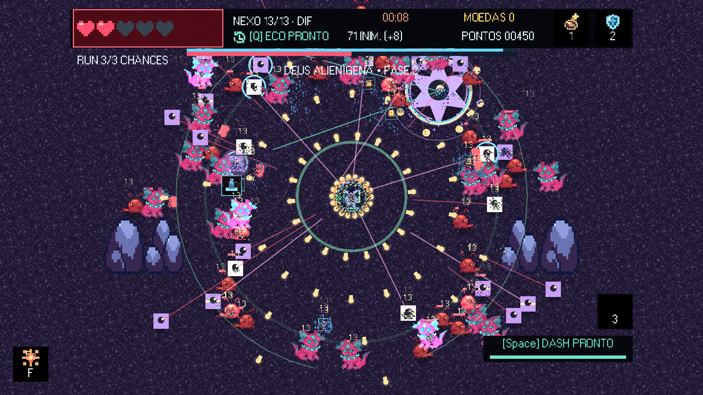
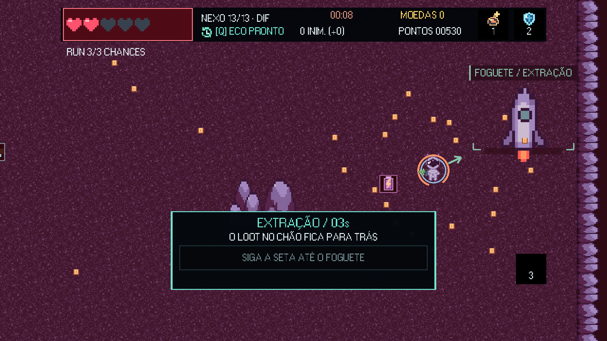
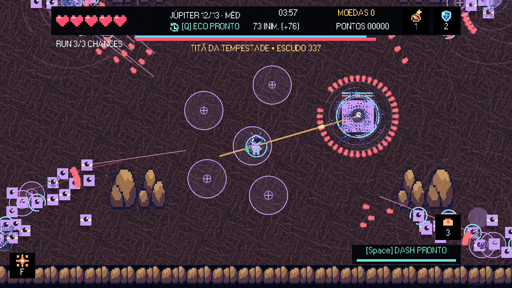
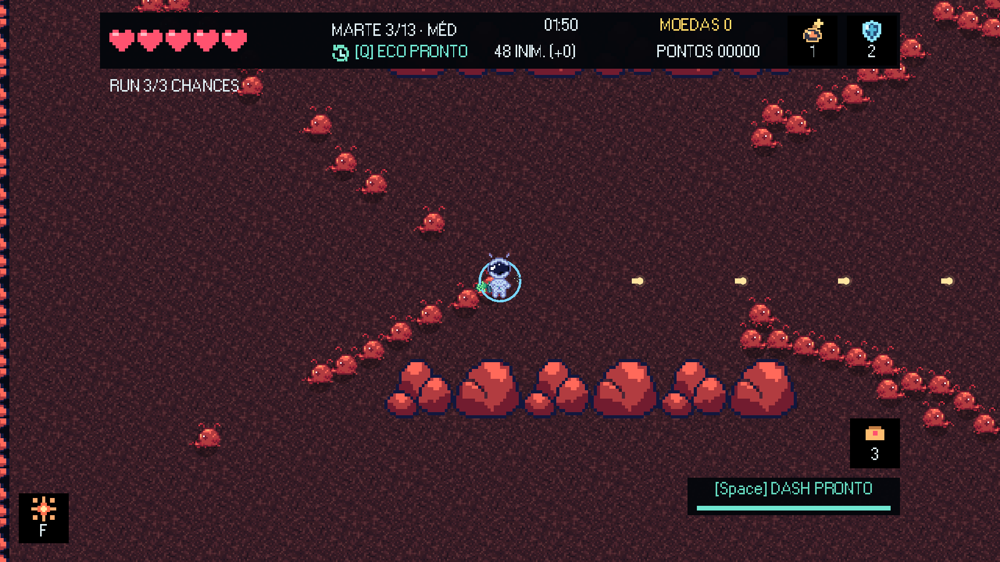
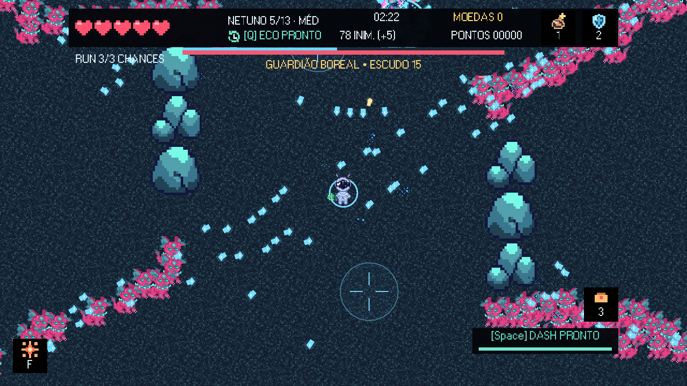
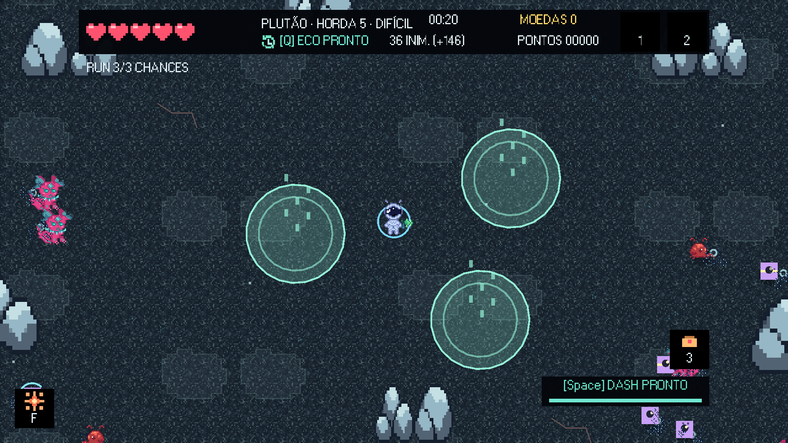
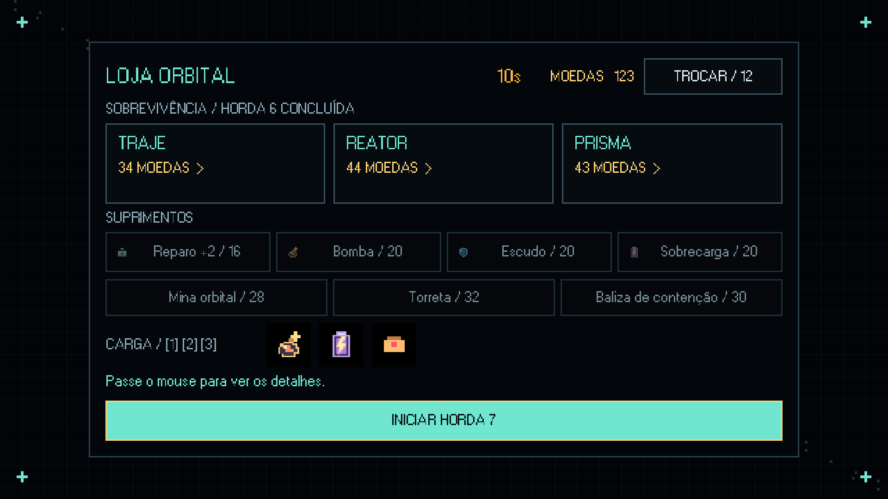
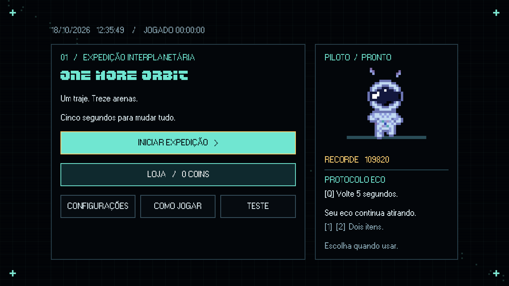
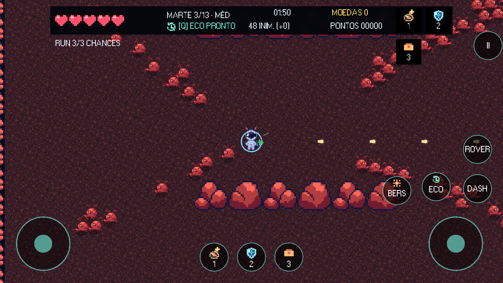

# One More Orbit

Protótipo 2D de arena para Godot **4.7.2 Standard / GDScript**, criado nesta pasta. Importe `project.godot` no gerenciador do Godot e aperte **F6** com a cena principal aberta, ou **F5** para executar o projeto. Não precisa instalar plugins nem baixar assets.

**Para editar o visual no editor:** veja [Editar no Godot](docs/EDITAR_NO_GODOT.md). Menu, controles, HUD, pausa, upgrades, resultado, arena e atores agora possuem cenas `.tscn` próprias em `scenes/`. O tema compartilhado está em `ui_theme.tres`. Importe o `project.godot` da raiz, não o arquivo existente dentro de `docs`.

## Imagens do jogo

### Caos no combate e urgência na extração



Mais de 70 inimigos na tela, tiros em todas as direções e dois corações restantes.



Só três segundos para alcançar o foguete. O loot no chão fica para trás.

### Planetas, modos e interface



| Marte | Netuno |
| --- | --- |
|  |  |
| **Sobrevivência infinita** | **Loja entre hordas** |
|  |  |
| **Menu principal** | **Controles por toque** |
|  |  |

Capturas em **1920×1080**. [Arquivos e instruções de captura](docs/media/README.md). [Fundo de Júpiter em PNG](docs/media/jupiter-fundo.png).

## Versão atual: 0.2.0

- Chefe de Netuno animado com os três frames originais de `assets/mobs_netuno/mob_neturno2`.
- Tela expandida para preencher 1920×1080 e outras proporções sem bordas, com escala uniforme e HUD centralizada.

- Após a vitória, 15 segundos para coletar e embarcar. O loot deixado no chão é perdido.
- Sirene progressiva, alerta vermelho e seta até o veículo; a pausa congela a coleta.
- Loja da run com limite de 20 segundos; compras não reiniciam o prazo. Depois, a viagem começa automaticamente.
- Rover entre arenas do mesmo planeta; foguete entre planetas. Ambos têm animação e som próprios.
- Áudio de morte fornecido pelo time e músicas com loop contínuo.

## Clonar e executar

```powershell
git clone https://github.com/Honorato1337/Noctir.git
```

Abra `project.godot` da raiz no Godot 4.7.2 Standard, espere a importação dos recursos e pressione F5. O cache `.godot` é recriado automaticamente.

Para exportar no Windows, instale Python, indique o executável do Godot e execute:

```powershell
$env:GODOT_BIN = "C:/caminho/Godot_v4.7.2-stable_win64.exe"
python tools/export_game.py
python tools/verify_exports.py
```

O script prepara os templates e as ferramentas Android em `.godot/export-tools`. Os pacotes ficam em `builds/windows` e `builds/android`. Builds, logs, arquivos temporários e chaves de assinatura são locais e não são enviados ao repositório. Guarde um backup privado de `.export-signing` para atualizar o mesmo APK. Consulte [Exportação](docs/EXPORTACAO.md).

## O que já funciona

- Treze arenas: quatro em Marte, quatro em Netuno, quatro em Júpiter e o Nexo final com o Deus Alienígena. Consulte o [catálogo de arenas](docs/ARENAS.md).
- Arenas de 1536 × 896 px com câmera suave acompanhando o astronauta e HUD fixa.
- After Burner Neue só no título do menu; W95FA na interface restante, com bordas quadradas, painéis escuros e detalhes de grade. A fonte original e seus arquivos de licença foram preservados em `fonts/after_burner_neue`.
- Menu com astronauta animado, recorde junto ao personagem, data e hora locais em tempo real e tempo total acumulado nas partidas; controles, pausa e resultado seguem o mesmo tema. Navegação por teclado com foco visível.
- Configurações de volume geral (0–100%), mudo e teste de som, com salvamento automático.
- Mini tutorial no rodapé durante a primeira arena: movimento, tiro, dash, Eco, itens, extração e pausa. Some nas lojas, menus e fases seguintes.
- Loja permanente no menu: 100 pontos da run rendem 1 coin, com sobras acumuladas. Seis melhorias com níveis e preços crescentes ficam salvas para as próximas tentativas. Veja [Progressão permanente](docs/PROGRESSAO_PERMANENTE.md).
- HUD objetiva: faixa superior de 72 px, fonte W95FA de 22 px e dois slots pretos com ícones. A vida usa corações pixelados, destaque ao sofrer dano e alerta pulsante com dois ou menos corações. Tempo, fase, moedas, inimigos, pontos e eco ficam no topo.
- Consumíveis exibem o mesmo ícone no chão e no slot; o ícone desaparece ao usar o item.
- Hordas de 36 a 102 inimigos, limite de 80 ativos, cronômetro e colisões com pilares.
- Marte: artrópodes de ferrugem perseguidores; Netuno: sentinelas de gelo que mantêm distância e disparam estilhaços duplos; Júpiter: autômatos de tempestade com investida anunciada.
- Perigos: geadas periódicas e rajadas em Netuno e vento em Júpiter. São ficção científica, não uma simulação de vida extraterrestre.
- Um chefe em cada arena; nas fases 4, 8 e 12 há superchefes com três fases, ataques anunciados e reforços extras.
- Loja após cada arena: três cartões de módulos, reparos e consumíveis com ícones, prévia dos dois slots e indicação de módulos instalados; seta de extração e passagem pelo portal.
- Moedas em 55% dos abates, atração de 80 px, prazo de 14 segundos, valores raros e bônus por coleta rápida. Chefes e superchefes garantem recompensas maiores. Loja com promoções, preços crescentes para módulos repetidos, estoque limitado e troca paga de ofertas. Chance de 2,5% de consumível; dois slots usados nas teclas 1 e 2. Veja [Combate e loja](docs/COMBATE_E_LOJA.md).
- Faíscas, explosões, números de dano, partículas de coleta e tremida de câmera.
- Astronauta animado com os cinco frames do time em `asssets/astronauta`, a 10 FPS e escala 2x. Veja [Animação do astronauta](docs/ANIMACAO_ASTRONAUTA.md).
- Arma do time em `assets/gun/gun.png`, com rotação pela mira, inversão ao mirar para a esquerda e reprodução da direção no Eco.
- Abertura com soundmenu1 uma vez, seguida de SoundMenu em loop infinito. O jogo usa cópias WAV sem a longa cauda silenciosa em `musica/processed`; os MP3 originais foram preservados. Volume e mudo continuam funcionando.
- 22 efeitos sonoros originais 8-bit já integrados em `assets/audio/sfx`, com limite de vozes simultâneas e prioridade para dano e alertas. [Biblioteca e prévia](assets/audio/README.md).
- Inimigo pequeno de Marte animado com os três frames fornecidos pelo time; chefe preservado até a chegada da nova arte.
- Dash com indicação de segundos restantes e barra de recarga no canto inferior direito.
- [Plano de áudio completo](docs/PLANO_DE_AUDIO.md): sugestões de sons para combate, habilidades, itens, interface, chefes e planetas.
- Dash com invulnerabilidade, rebobinador de cinco segundos e eco que repete os tiros e os frames gravados.
- Pontuação por abates e tempo restante, recorde salvo localmente, vitória, derrota, pausa e reinício rápido.

Veja também [configurações, joystick e celular](docs/CONFIGURACOES_E_CONTROLES.md).

## Controles

| Ação | Controle |
| --- | --- |
| Movimento | WASD |
| Mira e disparo | Mouse + botão esquerdo, ou setas direcionais |
| Dash | Espaço |
| Rebobinar e criar eco | Q, uma vez por arena, após 1 segundo de histórico |
| Entrar na próxima arena | Aproximar-se do rover e apertar E; viagem de nave |
| Usar consumíveis | 1 e 2 |
| Pausa | Esc |
| Recomeçar após vitória/derrota | R |

O rebobinador restaura a posição, recupera vida perdida e devolve até cinco segundos ao cronômetro. Inimigos derrotados continuam mortos; o mundo não é rebobinado. O eco reproduz posições e tiros gravados. É uma regra intencional de paradoxo temporal, não um rollback integral. Q precisa ser usado **antes** do dano fatal. Módulos e moedas da arena são zerados entre partidas; recorde, coins permanentes e melhorias da loja do menu ficam salvos.

## Organização

| Arquivo | Responsabilidade |
| --- | --- |
| `scripts/game.gd` | Estados da partida, spawn, cronômetro, navegação das telas e colisão simples |
| `scenes/ui/*.tscn` | Telas editáveis e HUD; estilos em `ui_theme.tres` |
| `scenes/world/*.tscn` | Treze layouts com piso, coberturas e marcadores editáveis |
| `scripts/arena_layout.gd` | Lê o layout da cena para posicionamento e colisão |
| `scripts/hud.gd` | Atualiza os textos dinâmicos sem modificar o layout |
| `scripts/loot_system.gd` | Moedas, drops, dois slots e ativação de consumíveis |
| `scripts/economy.gd` | Preços, promoções, chances de moedas e prazos de coleta |
| `scripts/progression.gd` | Coins por pontuação, melhorias permanentes e save local |
| `scripts/heart_meter.gd` | Corações, espaços de vida vazios e alerta de vida baixa |
| `scripts/user_settings.gd` | Volume, mudo, relógio local e tempo de jogo acumulado |
| `scripts/combat_fx.gd` | Partículas, impactos, texto de dano e câmera |
| `scripts/player.gd` | Movimento, tiro, dash, dano, histórico e eco |
| `scripts/enemy.gd` | Três comportamentos e chefe |
| `scripts/projectile.gd` | Projéteis aliados/hostis, acerto e cobertura |
| `scripts/planets.gd` | Cores, identidade dos planetas, velocidade e catálogo de módulos |
| `docs/GUIA_DA_JAM.md` | Configuração, plugins, direção criativa, escopo e roteiro de 48h |
| `tests/smoke.gd` | Verificação automatizada dos principais fluxos |

Os atores usam Node2D e colisões circulares/retangulares em código para manter a base pequena. Ao evoluir para mapas complexos, substituam movimento por CharacterBody2D e cenários por TileMapLayer; não é necessário para testar este loop. O astronauta usa os sprites criados pelo time; os inimigos e cenários mantêm o desenho geométrico provisório. O menu usa a música fornecida pelo time. Ainda requer testes humanos de dificuldade, sensação de tiro, controles e legibilidade em outras resoluções.

## Verificar por terminal

Com o executável do Godot no PATH, a partir desta pasta:

```powershell
godot --headless --path . --editor --import --quit
godot --headless --path . --script res://tests/smoke.gd
```

O teste exercita dano, invulnerabilidade, colisões, histórico, eco, melhorias, treze arenas, rotas de navegação, extração, vitória, derrota e reinício. Verifica também a fonte e a altura compacta da HUD. Não substitui jogar a partida.

## Exportar

Instale os **export templates da mesma versão do editor** em Editor > Manage Export Templates. Em Project > Export, crie um preset Windows Desktop e/ou Web. Exporte Windows para `builds/windows/OneMoreOrbit.exe`; Web para `builds/web/index.html`, com Thread Support desabilitado. Teste o ZIP inteiro no navegador da página da jam; não abra o HTML com `file://`. Veja as instruções completas no guia.

## Sobre o evento

O PDF enviado define One More Time como um loop que convida a novas tentativas, com decisões e progressão. Também informa que projetos começados antes do fim de semana da jam não são aceitos. Confiram as datas, regras completas, política de IA e licenças com a organização antes de submeter; o PDF fornecido é um guia de temas, não contém todas essas informações. Este projeto é uma base de protótipo, não uma inscrição já validada pelo evento.


## Expansão: ciclos, equipamentos e testes

Cada Prestígio aumenta em 1 o nível máximo de todos os atributos. Não há teto de ciclos definido no jogo: a vida dos inimigos cresce 18% por ciclo, e o dano sobe a cada quatro ciclos. O piloto mantém uma base de +1 vida e +10% de dano por ciclo, além dos níveis comprados. Veja [progressão](docs/PROGRESSAO_PERMANENTE.md).

O dash percorre cerca de 204 px. A tecla **3** coloca o equipamento de chão do terceiro slot: mina de grande área, torreta ou baliza de contenção. Os slots 1 e 2 continuam exclusivos para consumíveis.

O menu **Teste** abre qualquer uma das 13 arenas ou seu chefe, com escolha de equipamento e invulnerabilidade opcional. Não concede progresso nem altera recordes. A arena 13 combina as famílias de mobs e um chefe com meteoros, atração, prisão, escudos e dash.

Detalhes de implementação e testes: [expansão](docs/EXPANSAO_INFINITA.md).

## Sobrevivência infinita (0.2.0)

Em Iniciar Expedição, selecione Sobrevivência no seletor de modo e escolha Fácil, Médio ou Difícil. A arena mede 2048×1344: exatamente o dobro da área da arena inicial (1536×896), sem esticar os pixels.

Hordas numeradas com quantidade finita de inimigos em cada uma. Ao eliminar todos os inimigos, o loot restante é recolhido e a loja abre por **10 segundos**. Ao acabar o prazo (ou continuar), começa a próxima horda, com mais inimigos e mais vida. A dificuldade determina tamanho e ritmo dos lotes de entrada. Chefes a cada terceira horda; cada terceiro chefe é um superchefe e cada sexto é o Deus Alienígena. As espécies entram progressivamente. Não há horda final; apenas a quantidade simultânea e a velocidade são limitadas para preservar desempenho e controle.

As três chances valem para toda a run. Coins mantêm os multiplicadores de 25%/100%/150%, e contratos continuam indisponíveis no Fácil. Não há extração neste modo.

Baliza de contenção: raio de 320 px, duração de 20 segundos, redução de velocidade de 80% nos mobs e 50% nos chefes. Limpa projéteis hostis no raio a cada 0,35 segundo.

Verificação: `Godot --headless --path . --script tests/survival.gd`.

No modo Sobrevivência, Berserk recarrega em 90 segundos e Eco em 45 segundos desde o uso, contados somente durante o combate. Os temporizadores persistem entre hordas e mortes e congelam na loja e nos menus. Berserk continua exigindo a habilidade desbloqueada. Na campanha, Berserk continua limitado a uma vez por run e Eco a uma vez por arena. Os indicadores usam ícones de rajada radial e retorno temporal com texto compacto; nos controles por toque, os próprios botões mostram os segundos restantes.

Visual 0.2.0: arma e arma do Eco orbitam a 22 px do pivô (antes 16 px). Alcance e largura dos projéteis permanecem iguais. Berserk usa slot preto de 64×64 no canto inferior esquerdo, com ícone, tecla configurada e contagem de recarga sobre o ícone. Quando pronto, o ícone fica aceso; detalhes aparecem ao passar o mouse. O contrato foi deslocado para não sobrepor o slot.

## Plutão: Planície do Exílio

Arena exclusiva da Sobrevivência: 2048×1344, início no centro, oito formações de rocha congelada e caminhos largos para fugir das hordas. A arte reaproveita os recortes de pixel art do jogo em uma paleta própria, com gelo claro, chão escuro, placas de nitrogênio e fissuras avermelhadas.

Eventos aleatórios alternam sem repetir imediatamente o anterior:

- **Erupções de nitrogênio:** gêiseres marcados explodem e deixam gás que causa dano e reduz a velocidade dentro da área.
- **Chuva de cometas:** impactos de gelo com indicação prévia no chão.
- **Fendas gravitacionais:** dois núcleos móveis atraem o astronauta, acompanhados de colapsos espaciais marcados.
- **Nevasca cósmica:** vento lateral, frio que reduz levemente a velocidade e chuva de gelo.

Eventos começam após uma folga inicial de 8–13 segundos. Há aviso de 2 segundos, marcas de impacto de pelo menos 1,1 segundo e intervalos de descanso. O modo difícil cria ameaças com mais frequência. Loja, pausa e tela de morte interrompem os eventos; ao abrir a loja ou retornar de uma morte, as ameaças são limpas.

Validação: `Godot --headless --path . --script tests/pluto_survival.gd`. Para atualizar a captura da arena: `Godot --path . --script tests/pluto_survival.gd -- --preview`.
