# One More Orbit

Um traje. Treze arenas. Cinco segundos para mudar tudo.

**Sobreviva às hordas, rebobine o combate e alcance a extração antes que o tempo acabe.** One More Orbit é um jogo 2D de ação em pixel art, com campanha pelo Sistema Solar, sobrevivência infinita e progressão entre tentativas.

[**Baixar para Windows**](https://github.com/Honorato1337/Noctir/releases/download/v0.2.9/OneMoreOrbit.exe) · [**Baixar para Android**](https://github.com/Honorato1337/Noctir/releases/download/v0.2.9/OneMoreOrbit.apk) · [Todas as versões](https://github.com/Honorato1337/Noctir/releases)

Últimos instaladores publicados: **v0.2.9**, com bomba de alcance limitado, dano por distância e até 12 alvos. A espingarda continua permanente em Equipamentos por 3 SpaceCoins.

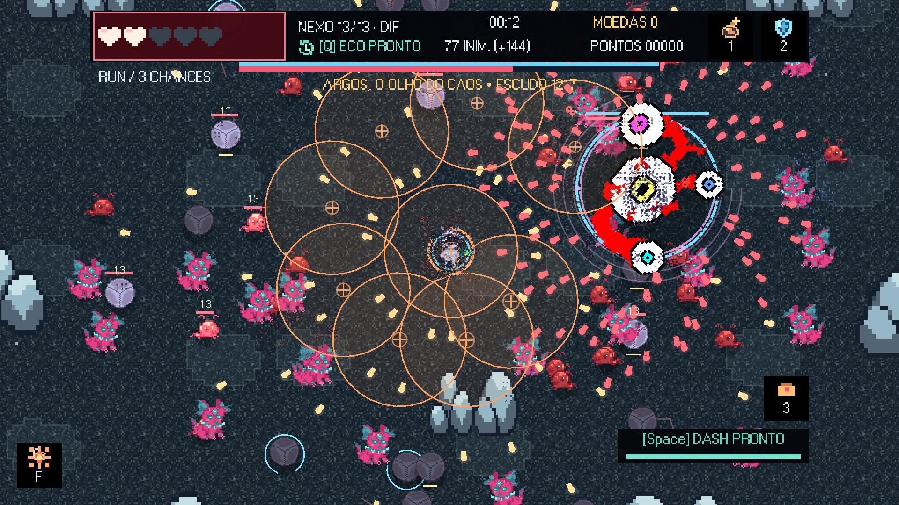

## Só mais uma órbita

- **Eco temporal:** volte até cinco segundos e deixe uma cópia repetindo seus movimentos e disparos.
- **Armas:** comece com a arma original de tiro simples. Desbloqueie a espingarda por 3 SpaceCoins em Loja → Equipamentos: três projéteis, cadência menor e animação própria. Escolha a arma das próximas runs na aba Equipamentos; compra e seleção ficam salvas.
- **Campanha:** quatro arenas em Marte, quatro em Netuno, quatro em Júpiter e o confronto final no Nexo.
- **Sobrevivência:** hordas crescentes em Plutão, inimigos dos três planetas e loja de dez segundos entre ondas.
- **Superchefes:** ataques próprios, escudos, investidas e eventos de arena. Cada superchefe planetário da campanha devolve uma chance.
- **Bomba com alcance limitado:** no máximo 12 alvos próximos, com dano de 100%/50%/25% nas faixas de 120/240/360 px.
- **Extração urgente:** quinze segundos para coletar e embarcar. Atrasar custa os três slots e um terço das moedas da run.
- **Escolhas entre partidas:** melhorias permanentes, contratos por SpaceCoin, habilidades, Prestígio e skins.
- **Celular mais leve:** menos inimigos por horda, até 32 ativos, partículas reduzidas e renderização interna com limites próprios de efeitos.
- **Três dificuldades:** Fácil, Médio e Difícil; teclado, joystick e controles por toque.

[Ver a espingarda em Loja → Equipamentos](docs/media/equipamentos-espingarda.png). Compra permanente de **3 SpaceCoins**, seleção salva e arma original gratuita.

## Galeria

| Marte · Mandíbula Ferrugem | Netuno · Cervo Abissal |
| --- | --- |
| 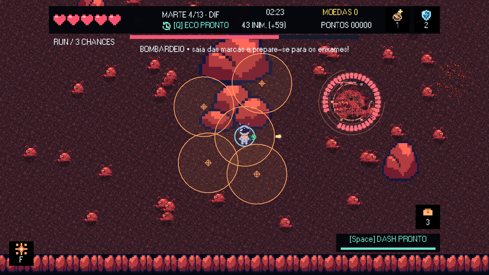 | 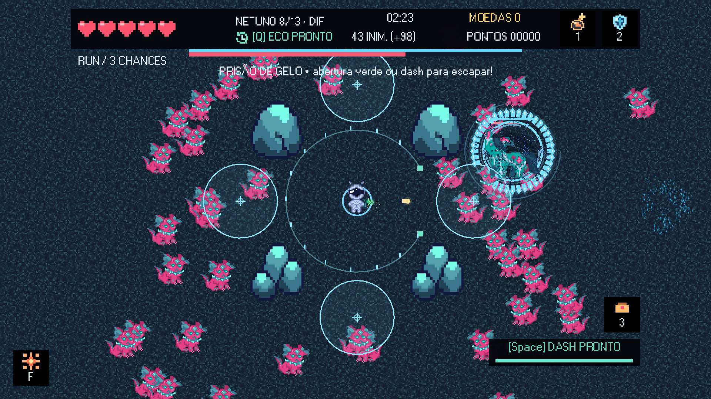 |
| **Júpiter · Cubos da Tormenta** | **Plutão · Sobrevivência** |
| 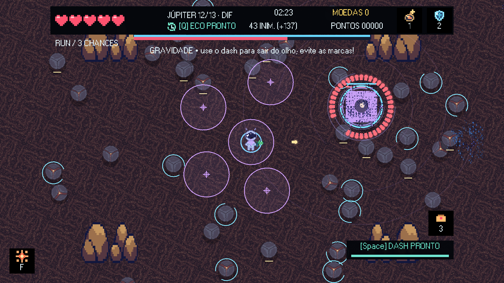 | 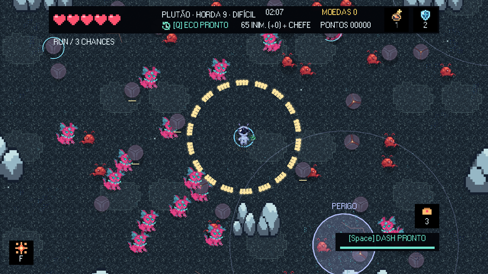 |
| **Extração · Três segundos restantes** | **Loja · Decisões sob pressão** |
| 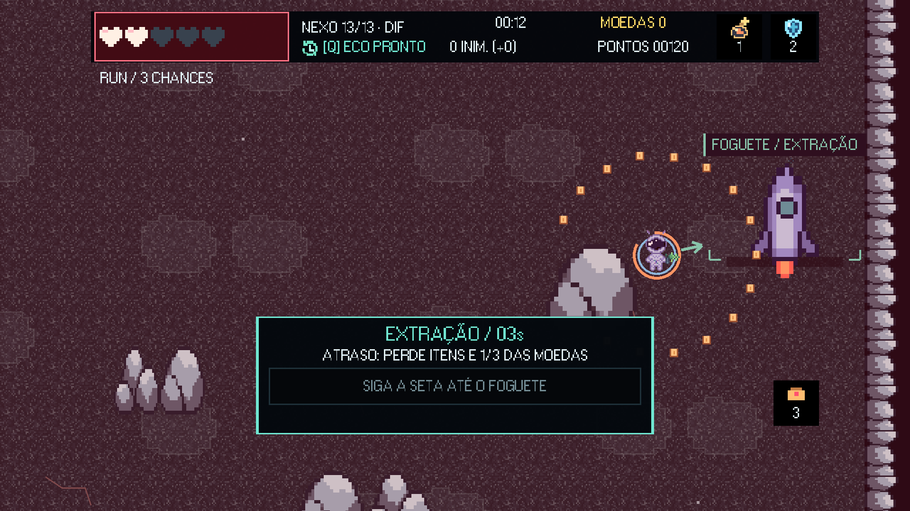 | 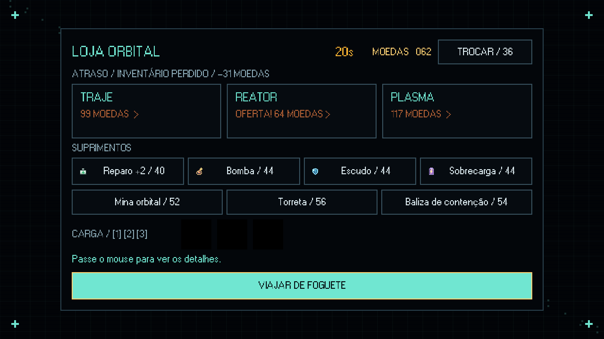 |
| **Menu principal** | **Controles para celular** |
| 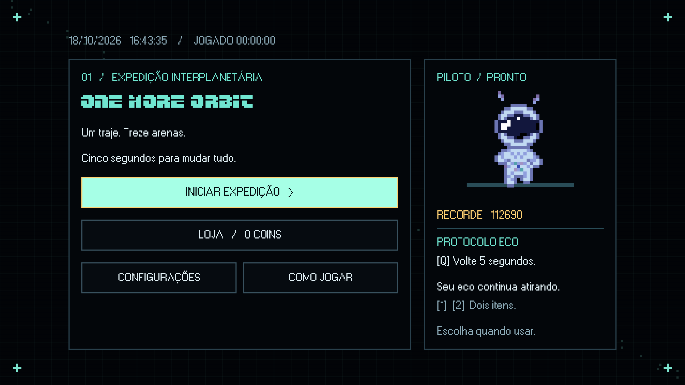 | 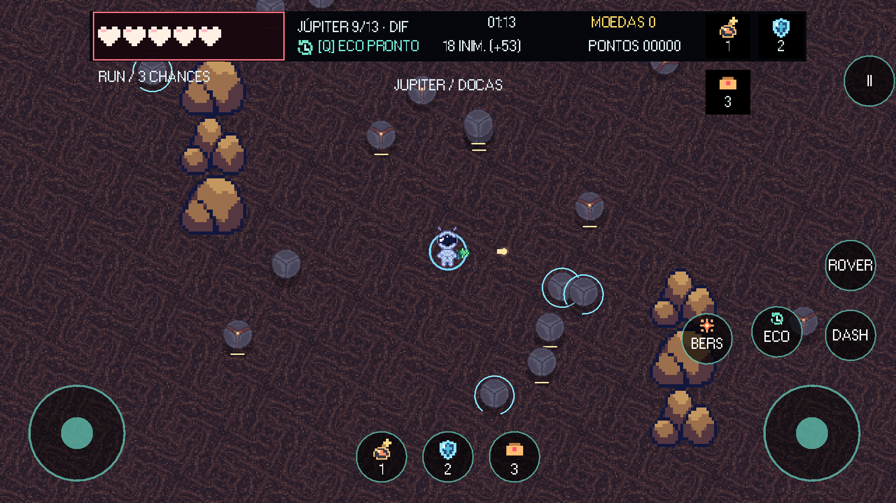 |

[**Baixar as 10 prints em ZIP**](docs/media/one-more-orbit-prints.zip) · [Galeria completa e legendas](docs/media/README.md)

Capturas Full HD **1920×1080**, renderizadas no Godot a partir da branch `main`. São cenários de demonstração montados por script para mostrar as artes, o combate e as interfaces atuais. Os PNGs não receberam montagens ou efeitos externos. As imagens antigas foram mantidas fora da galeria principal.

## Mecânicas em movimento

| Movimento | Andando e atirando |
| --- | --- |
| 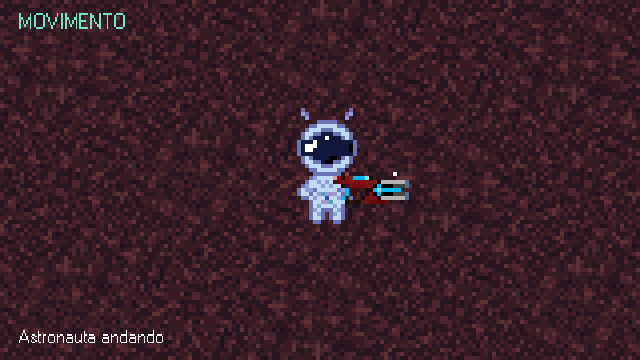 | 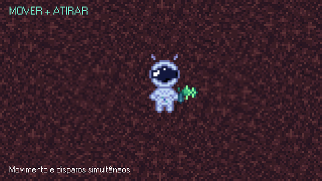 |
| **Espingarda** | **Eco temporal** |
| 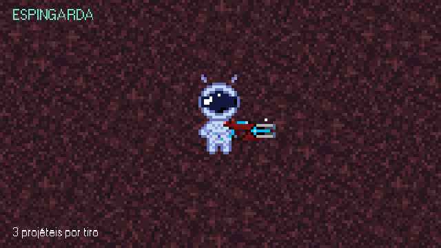 | 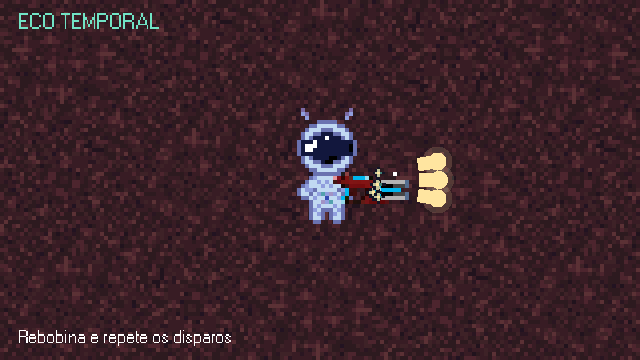 |

[**Ver os oito GIFs**](docs/media/gifs/README.md) · [**Baixar o pacote em ZIP**](docs/media/one-more-orbit-gifs.zip)

Inclui movimento, espingarda comprada, movimento com a arma original, Prisma, dash, Eco, Berserk e tiro simples. A arma original é a inicial gratuita; a espingarda é um equipamento opcional de 3 SpaceCoins. A arma escolhida na aba Equipamentos inicia as próximas runs.

## Habitantes de cada órbita

| Local | Inimigos | Chefe | Superchefe |
| --- | --- | --- | --- |
| Marte | Gosma Rubra | Devorador de Sucata | Mandíbula Ferrugem |
| Netuno | Espinho Boreal | Lanceiro Boreal | Cervo Abissal |
| Júpiter | Cubo Investidor, Cubo Artilheiro e Cubo Gravitacional | Núcleo da Tormenta | Titã de Íons |
| Nexo | Espécies dos três planetas | **Argos, o Olho do Caos** | Confronto final |

Os nomes acompanham as silhuetas: gosmas e mandíbulas de ferrugem em Marte, espinhos e formas animais em Netuno, autômatos cúbicos em Júpiter e um organismo de vários olhos no Nexo.

[**Ver o bestiário ilustrado**](docs/BESTIARIO.md)

## Como jogar

No Windows, baixe o `.exe` e execute. No Android, instale o `.apk` da seção Releases. Não é necessário instalar o Godot para jogar.

| Ação | Tecla padrão |
| --- | --- |
| Mover | WASD |
| Mirar e atirar | Mouse + botão esquerdo ou setas |
| Dash | Espaço |
| Eco temporal | Q |
| Berserk, após desbloquear | F |
| Consumíveis | 1 e 2 |
| Equipamento de chão | 3 |
| Embarcar | E, próximo ao veículo |
| Pausar | Esc |

Em Configurações, ajuste os volumes de música, efeitos e interface, a resolução e as teclas. Há preset de movimento pelas setas, suporte a joystick e controles por toque. [Detalhes dos controles](docs/CONFIGURACOES_E_CONTROLES.md).

Você começa com **três chances por run**. Na campanha, o Eco tem uma carga por arena e Berserk é usado uma vez por run; na sobrevivência, ambos recarregam durante o combate. A loja da campanha dura vinte segundos. Rover transporta entre arenas do mesmo planeta; foguete faz as viagens entre planetas.

## Abrir o projeto

Feito em **Godot 4.7.2 Standard / GDScript**, sem plugins obrigatórios.

```powershell
git clone https://github.com/Honorato1337/Noctir.git
```

Importe o `project.godot` da raiz, espere a importação dos recursos e pressione **F5**. Telas e arenas têm cenas editáveis em `scenes/`; o código fica em `scripts/`.

| Documentação | Conteúdo |
| --- | --- |
| [Editar no Godot](docs/EDITAR_NO_GODOT.md) | Cenas, HUD e menus |
| [Arenas](docs/ARENAS.md) | Organização dos mapas |
| [Bestiário](docs/BESTIARIO.md) | Artes, nomes e comportamentos |
| [Combate e loja](docs/COMBATE_E_LOJA.md) | Itens, economia e módulos |
| [Progressão](docs/PROGRESSAO_PERMANENTE.md) | Coins, atributos e saves |
| [Exportação](docs/EXPORTACAO.md) | Gerar e verificar EXE/APK |
| [Histórico de implementação](docs/HISTORICO_IMPLEMENTACAO.md) | Registro das etapas anteriores |

Para gerar as capturas atuais:

```powershell
godot --path . --script tools/capture_gallery.gd
python tools/package_screenshots.py
```

Testes de referência: `tests/smoke.gd`, `tests/enemy_art.gd`, `tests/shotgun.gd` e `tests/planet_mechanics.gd`. Execute com `godot --headless --path . --script CAMINHO_DO_TESTE`.

## Arte e áudio

Os sprites do astronauta, Guanapo, espingarda e inimigos foram criados pelo autor do projeto. As artes originais ficam preservadas em `assets/` e `asssets/astronauta/`. Há cenários e efeitos gerados durante o desenvolvimento; os chefes de Júpiter ainda utilizam visuais procedurais. O menu usa o áudio fornecido pelo autor, e as trilhas planetárias originais combinam eletrônica espacial com identidades próprias: Marte a 128 BPM, Netuno com post-punk a 160 BPM e Júpiter a 216 BPM.

Projeto em desenvolvimento. As capturas mostram o estado atual da branch principal; os instaladores seguem a versão indicada na release.

## Atualização 0.3.0

Argos ficou duas vezes maior, e os Cubos da Tormenta, 50% maiores, com colisões e navegação ajustadas. As artes existentes ganharam pulsação, flutuação e pequenos saltos por transformação dos sprites. O Android possui perfil automático de desempenho; veja os [limites e detalhes](docs/CONFIGURACOES_E_CONTROLES.md#perfil-de-desempenho-do-celular-030).
