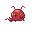
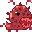
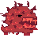
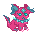
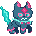
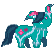
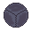
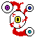
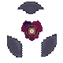
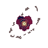

# Bestiário de One More Orbit

[Voltar ao jogo](../README.md) · [Galeria](media/README.md)

Nomes definidos a partir das artes atuais. As imagens abaixo são os PNGs originais do autor, sem redesenho. Os caminhos dos assets foram preservados para manter as animações e referências.

## Gosma Rubra

**Marte.** Uma pequena massa rubra, com olhos salientes e corpo de gosma. Persegue o astronauta em grupo.

## Devorador de Sucata

**Marte · chefe.** Corpo robusto de ferrugem, boca aberta e dentes. Investidas, rajadas e reforços.

## Mandíbula Ferrugem

**Marte · superchefe.** Uma grande mandíbula serrilhada, com espinhos e textura de sucata. Bombardeio, explosões marcadas e enxames.

## Espinho Boreal

**Netuno.** Criatura rosa e ciano, com carapaça e projeções pontudas. Mantém distância e dispara estilhaços.

## Lanceiro Boreal

**Netuno · chefe.** Figura ereta com máscara, orelhas e uma arma alongada de gelo. Escudo, deslocamento lateral e disparos.

## Cervo Abissal

**Netuno · superchefe.** Quadrúpede ciano com longas extremidades semelhantes a chifres. Prisão de gelo, geadas e escudo.

## Cubos da Tormenta

**Júpiter.** Autômatos cinzentos cúbicos, com uma abertura central. Investidor: dash e minas elétricas. Artilheiro: rajadas anunciadas. Gravitacional: atração e disparos.

## Argos, o Olho do Caos

**Nexo · final.** Organismo vermelho com um grande olho central e olhos nas extremidades. Meteoros, atração, prisões, escudos, rajadas e dash. Gira durante investidas e ataques circulares.

## Júpiter: funções e chefes

| Nome no jogo | Função e aparência |
| --- | --- |
| Cubo Investidor | Mesmo sprite cúbico; abre antes da investida e deixa minas elétricas. |
| Cubo Artilheiro | Mesmo sprite, com marcador amarelo; abre antes da rajada. |
| Cubo Gravitacional | Mesmo sprite, com aro ciano; cria atração e dispara. |
| Núcleo da Tormenta | Chefe com núcleo cercado por placas flutuantes; escudo e investidas. Sprite autoral `mob_jupiter2`. |
| Titã de Íons | Superchefe com sprite autoral `mob_jupiter3`, anéis, gravidade e explosões. |

Os dois chefes usam suas próprias animações de 21 frames, com flutuação, pulsação e rotação durante ataques.

## Nomes dentro do projeto

O catálogo está em [`scripts/enemy_names.gd`](../scripts/enemy_names.gd). A HUD, os avisos de chegada e as fases dos superchefes usam os mesmos nomes. A sobrevivência usa os mesmos nomes quando essas espécies aparecem em Plutão.
