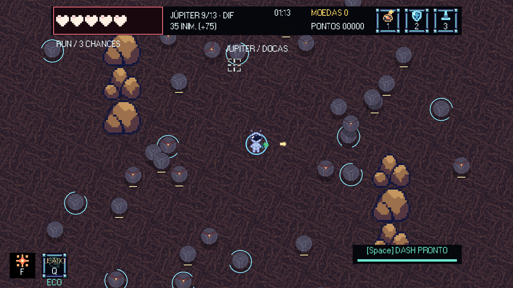
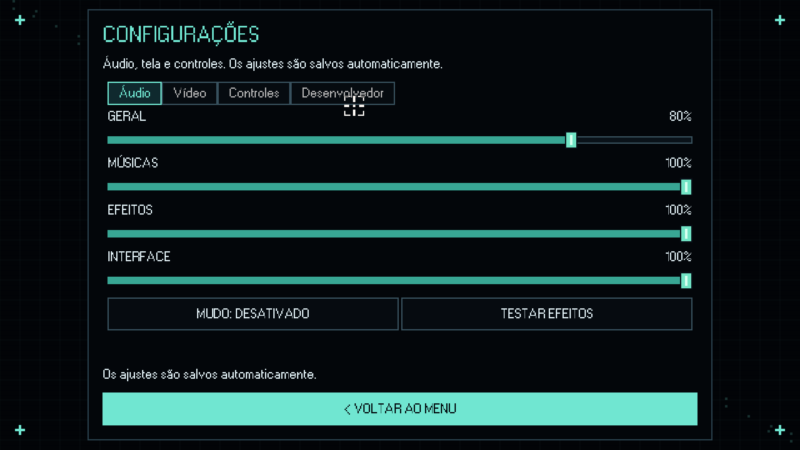
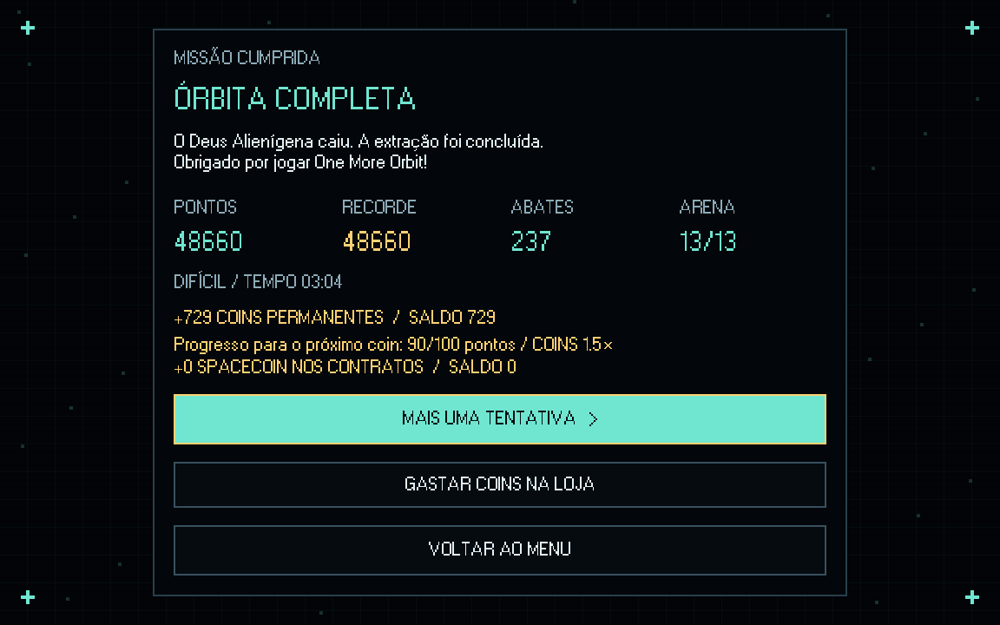

# Galeria de One More Orbit

[Voltar ao jogo](../../README.md) · [Baixar as 10 prints em ZIP](one-more-orbit-prints.zip) · [Bestiário](../BESTIARIO.md)

Capturas de 18/10/2026, em **1920×1080**, da versão **0.3.3**, incluindo as novas molduras dos slots e do Eco. Cenários de computador preparados por script e renderizados pelo próprio jogo, sem efeitos externos nos PNGs.

[Vídeo de 30 segundos na arena final](https://github.com/Honorato1337/Noctir/releases/download/v0.3.3/OneMoreOrbit-Nexo-30s.mp4).

## Menu principal e astronauta


## Marte: Mandíbula Ferrugem e Gosmas Rubras


## Netuno: Cervo Abissal e Espinhos Boreais


## Júpiter: Cubos da Tormenta e Titã de Íons


## Horda 9 em Plutão com inimigos de todos os planetas


## Argos em combate denso: mobs, rajadas, meteoros e Berserk


## Três segundos para embarcar: itens e moedas em risco


## Loja com prazo de 20 segundos e penalidade por atraso


## Eco e slots de consumíveis e equipamento



## Configurações de áudio com volumes separados



## Conclusão da campanha



A tela de vitória foi renderizada pelo jogo com estatísticas de demonstração, para apresentar o layout. Não é o registro de uma campanha jogada até o fim.

## GIFs das mecânicas

[Ver as oito animações](gifs/README.md) · [Baixar GIFs em ZIP](one-more-orbit-gifs.zip).

## Reproduzir e empacotar

```powershell
godot --path . --script tools/capture_gallery.gd
python tools/package_screenshots.py
```

O ZIP inclui dez PNGs, legendas, manifesto e hashes SHA-256. O script valida a resolução e a integridade de cada arquivo. As capturas são feitas com perfil temporário em memória, sem progresso ou compras no save do jogador.

## Arquivos anteriores e arte de cenário

Os PNGs numerados diretamente nesta pasta pertencem a capturas anteriores e foram preservados como histórico; a galeria atual fica em `gallery/`.

[Fundo de Júpiter](jupiter-fundo.png) · [Tile de Júpiter](jupiter-tile.png) · [Pedras de Júpiter em ZIP](jupiter-rochas.zip).
