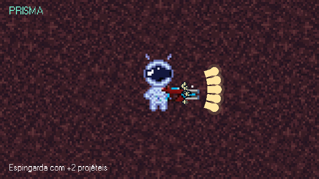
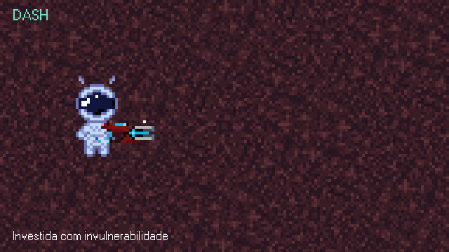
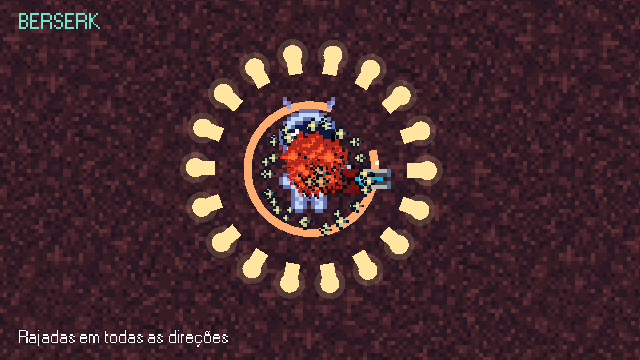
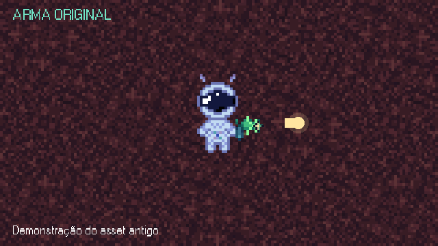

# Mecânicas em movimento

[Voltar ao jogo](../../../README.md) · [Baixar todos os GIFs em ZIP](../one-more-orbit-gifs.zip)

Oito GIFs em **640×360**, **20 FPS**, loop infinito e sem áudio. Capturados no Godot, com o astronauta e a câmera em uma área isolada para destacar as mecânicas. As legendas fazem parte da captura. Os frames foram codificados com paleta compartilhada e sem dithering para preservar a pixel art.

A arma original é a inicial gratuita. A espingarda é um equipamento permanente comprado por 3 SpaceCoins em Loja → Equipamentos. Após adquirir, é possível selecionar gratuitamente a arma das próximas runs nessa aba. Prisma e Berserk são variações de disparo, não armas separadas.

## MOVIMENTO

Astronauta andando.


## ESPINGARDA

3 projéteis por tiro.


## MOVER + ATIRAR

Movimento e disparos simultâneos.


## PRISMA

Espingarda com +2 projéteis.



## DASH

Investida com invulnerabilidade.



## ECO TEMPORAL

Rebobina e repete os disparos.


## BERSERK

Rajadas em todas as direções.



## ARMA ORIGINAL

Tiro simples e cadência rápida.



## Reproduzir as capturas

```powershell
godot --fixed-fps 20 --path . --script tools/capture_mechanics.gd
python tools/package_mechanics.py
```

Os PNGs intermediários ficam em `tmp/mechanics-frames`, fora do Git. O manifesto inclui duração, tamanho e hash SHA-256 dos GIFs. O ZIP contém os oito GIFs, o manifesto e este guia. Nenhuma mudança no sistema de armas é necessária para gravá-los.
